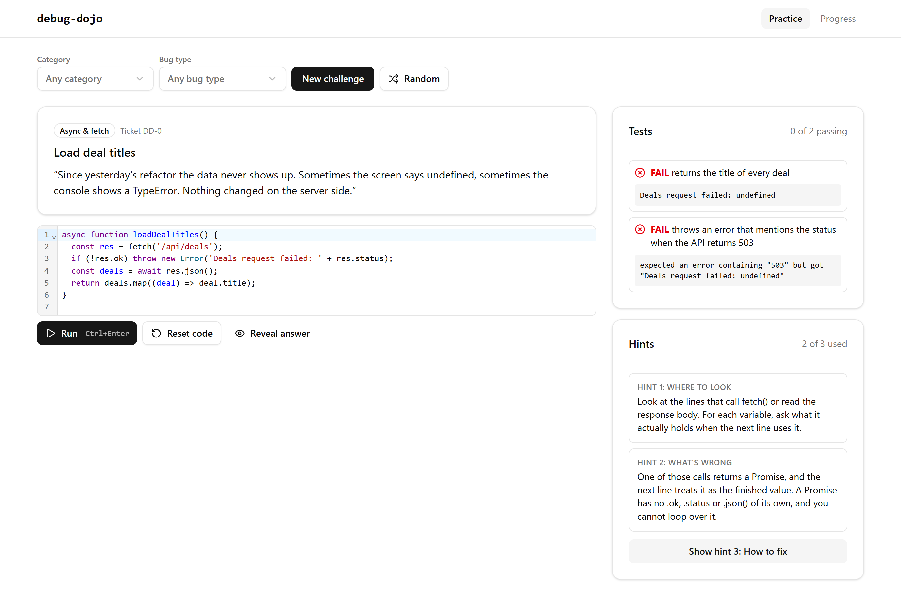
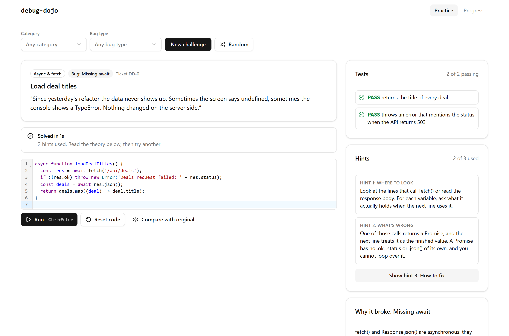
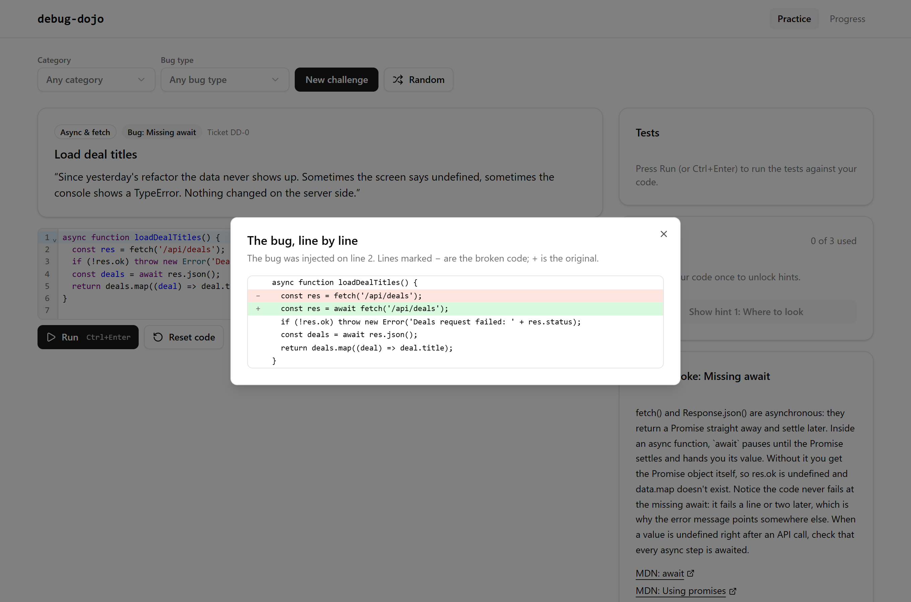
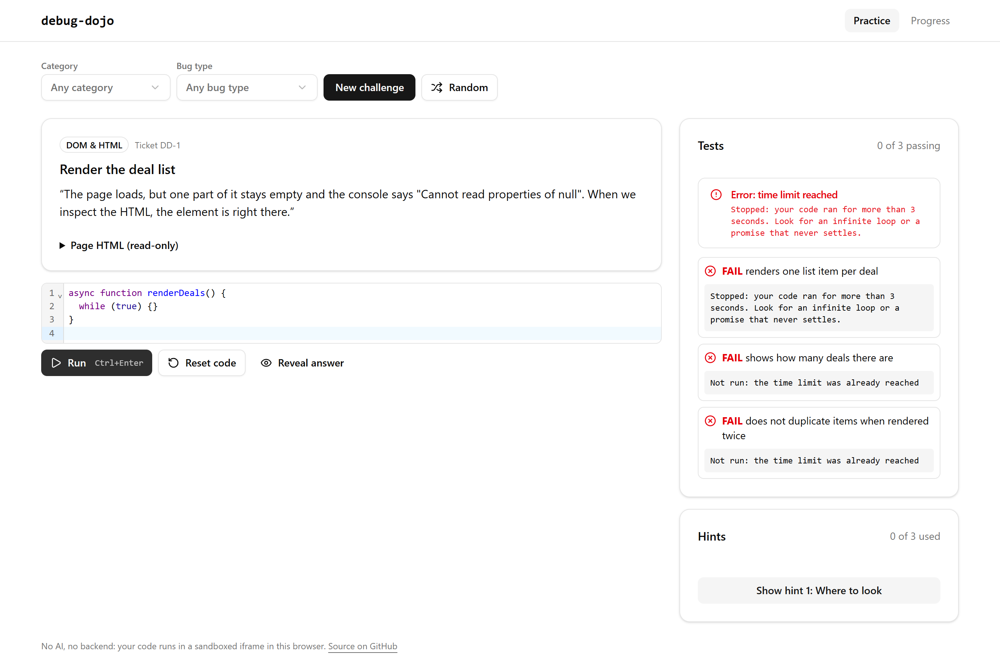

# debug-dojo

**Find the bug. Fix it. Know why.**

debug-dojo injects one realistic bug into a small JavaScript, HTML or API snippet, then coaches you to find and fix it. It shows a symptom report written like a customer ticket, gives tests to run your fix against, offers a 3-step hint ladder, and ends with a short theory note and a diff of the bug.

I built it to practise for a Client Engineering technical round (API debugging, JavaScript, HTML), and to get better at debugging without reaching for AI.

**Live:** https://andrewjoji.github.io/debug-dojo/ · **Spec:** [`docs/SRS.md`](docs/SRS.md)



## How it was built: scaffold vs hand-written

This is a **hybrid build**, and the split is deliberate:

| Who | What |
| --- | --- |
| **Claude (AI), in one scaffold PR** | Engine, sandbox, fake fetch, UI, tests, CI, deploy, this README, plus **3 example snippets and 3 example mutators** (marked `// scaffold-example`). |
| **Andrew, by hand, AI-off** | **Every** snippet and mutator after the scaffold, one per ~45-minute session with docs open. Each file starts with `// hand-written`. Sessions are logged in [`docs/practice-log.md`](docs/practice-log.md). |

AI is used afterwards only to review and explain, never to write snippets or mutators. The rules are in [`AGENTS.md`](AGENTS.md), and CI enforces the headers. To get the current count, run:

```
npm run authorship
```

At the scaffold, there are 0 hand-written files and 6 scaffold examples (3 snippets, 3 mutators).

## How it works

```
picker ──seed──▶ engine ──▶ (snippet, mutator, site) ──▶ broken code ──▶ editor
                                                                           │ Run
                                    results ◀── postMessage ◀── sandboxed iframe
                                                               (fake fetch, 3 s limit)
```

- **Snippets** (`src/snippets/`): a working piece of code, the tests that prove it works, optional page HTML, and fake API routes.
- **Mutators** (`src/mutators/`): one kind of bug. Each answers two questions: *where could this bug go?* (`findSites`) and *break it there* (`breakAt`). Each also carries the ticket, the three hints, the theory note and MDN links.
- **Deterministic:** the same snippet, mutator and seed always give the same bug (`src/engine/random.ts`, a seeded mulberry32 generator). The challenge lives in the URL (`#/c/<snippet>/<mutator>/<seed>`), so a reload or a shared link reproduces it exactly.
- **Sandboxed:** code runs in an `<iframe sandbox="allow-scripts">` with an opaque origin, so it can't touch the page, its storage or cookies.
  - A **fake `fetch`** returns set status codes, headers, delays and network errors, and records every request so tests can check the headers that were sent.
  - **Infinite loops** are stopped after 3 seconds. Before running, `acorn` parses the code and a guard is added inside every loop, because a sandboxed iframe can share the page's main thread and a parent timer alone could never fire. A kill timer covers promises that never settle.
- **Tested both ways:** the same harness code runs inside the iframe in the browser and directly under Vitest/jsdom in CI. The matrix test checks that every snippet passes clean, and that **every site of every mutator that applies** makes at least one test fail.
- **No AI and no backend.** It's a static site, and progress is stored in `localStorage`.

| Solved, with theory | The reveal diff | An infinite loop, stopped |
| --- | --- | --- |
|  |  |  |

## Run it

```
npm install
npm run dev        # http://localhost:5173/debug-dojo/
npm run check      # typecheck + authorship + tests + build (what CI runs)
```

## Add a snippet or a mutator

Add **one file**. You don't need to register it anywhere, because `import.meta.glob` picks it up.

1. Start the file with `// hand-written`.
2. Copy the shape of an example: `src/snippets/fetch-deal-titles.ts` or `src/mutators/remove-await.ts`.
3. Run `npm test`. The matrix test shows whether the snippet passes clean and whether every bug site is caught by a test.

Things worth knowing when you write one:

- Inside a snippet's `code` and `tests` (template literals), escape `` ` `` and `${`, or use string concatenation.
- To restrict a mutator to one spot, put a marker such as `/*@await*/` directly before that code. Markers are stripped before the code is shown.
- Tests can use `test(name, fn)`, `assert.ok / equal / deepEqual / rejects`, and `api.route(...)` / `api.requests` from the fake fetch.

## Stack

Vite, React and TypeScript, with shadcn/ui and Tailwind v4 for the UI. The engine and sandbox are plain TypeScript with no React. The editor is CodeMirror 6, diffs use jsdiff, the loop guard uses acorn, and tests run on Vitest with jsdom. It's deployed to GitHub Pages by Actions.

## License

MIT
